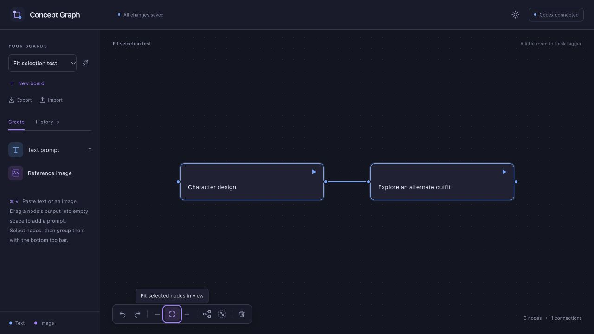

# Concept Graph

**A local canvas for image ideas and their evolution.**

Write a prompt, connect references, and run it. Generated images appear as connected nodes. Branch from any result, compare directions, and keep the path that led there.



Concept Graph runs in your browser with a local Node.js server and your signed-in Codex CLI. It is an independent project, not an OpenAI product.

## What you can do

- Connect text and image nodes to build context for a generation or edit.
- Paste text or images directly onto the canvas; duplicate and copy/paste selections.
- Branch by dragging an output into empty space, then type the next prompt.
- Keep separate boards, fold groups, align branches, and fit the current selection.
- Inspect original prompts and input images for earlier runs; download image originals.
- Export a board and its images as one `.conceptgraph` file, then import it as a new board.
- Switch between light and dark themes. Boards save automatically on your computer.

## Requirements

- **Node.js 22 or newer** and npm.
- **Codex CLI with native image-generation support**, signed in with your own ChatGPT account.
- A browser. macOS is locally tested; Linux is covered by automated CI. Native Windows is not currently verified; use WSL2 for a Unix environment.

This app deliberately rejects API-key authentication for generation. It uses the capabilities and usage allowance available to your Codex account; a subscription does not guarantee access to every feature or unlimited generations. The app checks image-generation support before running. See the [setup guide](docs/setup.md#codex-compatibility) for the tested CLI version and troubleshooting.

## Quick start from source

Install [Node.js](https://nodejs.org/en/download), then install and sign in to Codex:

```sh
npm install -g @openai/codex@0.163.0
codex login
```

Choose **Sign in with ChatGPT**, then:

```sh
git clone https://github.com/knifest-studio/concept-graph.git
cd concept-graph
npm ci
npm run build
npm start
```

Open **http://127.0.0.1:4317**. Keep the terminal open; press **Ctrl+C** to stop.

Prefer a ZIP? Download `concept-graph-v0.1.0.zip` from [Releases](https://github.com/knifest-studio/concept-graph/releases), extract it, run `npm ci --omit=dev`, then `npm start`. Release ZIPs include the built interface; GitHub's automatic **Source code** archives require a build. Node.js and Codex are installed separately.

For the complete installation, update, backup, and troubleshooting instructions, read the **[setup guide](docs/setup.md)**. Controls and board-file details are in the **[user guide](docs/user-guide.md)**.

## Your first branch

1. Add a **Text prompt** and describe an image. Click its play button.
2. Drag the result's output dot into empty space. A connected prompt opens with the cursor ready.
3. Describe the change and run it. Both the original and the new result stay on the board.

Only connected ancestors are sent as context. Unconnected ideas stay out of the run. Each run saves its original prompt and inputs so later edits do not rewrite history.

## Data and privacy

The server listens on `127.0.0.1`. Boards live in `data/workspace.json`; images live in `data/assets/`. Back up the **entire data directory**, or export a board for sharing. Exports include prompt text, image originals, and historical inputs: review them before sharing.

Connected prompts and images are sent to OpenAI when you run a prompt. Codex manages authentication separately; this app does not bundle or distribute login credentials. See [security notes](SECURITY.md) for the local trust model. Do not expose this server as a public or shared service.

## Development

```sh
npm ci
npm test
npm run build
npm start
```

Tests use a deterministic fake Codex worker and do not call OpenAI. Use `CONCEPT_GRAPH_DATA` to point experiments at a separate folder. The app is React + React Flow, a small Node HTTP server, and a JSON-RPC bridge to `codex app-server`.

See [CONTRIBUTING.md](CONTRIBUTING.md) for development and release instructions, and [CHANGELOG.md](CHANGELOG.md) for changes.

## Current limits

One active generation across all boards; up to 10 connected image inputs per run; 30 MB per image. Groups have one level. Undo history ends when you switch boards or reload. Use one browser tab per board. Generation shows elapsed seconds because Codex does not provide a reliable percentage or ETA.

The Codex app-server integration is experimental and may need changes after Codex updates. The account handshake was checked with public CLI **0.163.0**; the original image-generation workflow was exercised with **0.162.0-alpha.17.2**. CI checks the app with a fake worker, not a paid account.

## License

[MIT](LICENSE). Third-party dependencies retain their own licenses; see [THIRD_PARTY_NOTICES.md](THIRD_PARTY_NOTICES.md).
