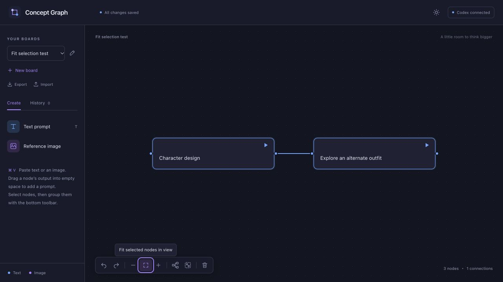
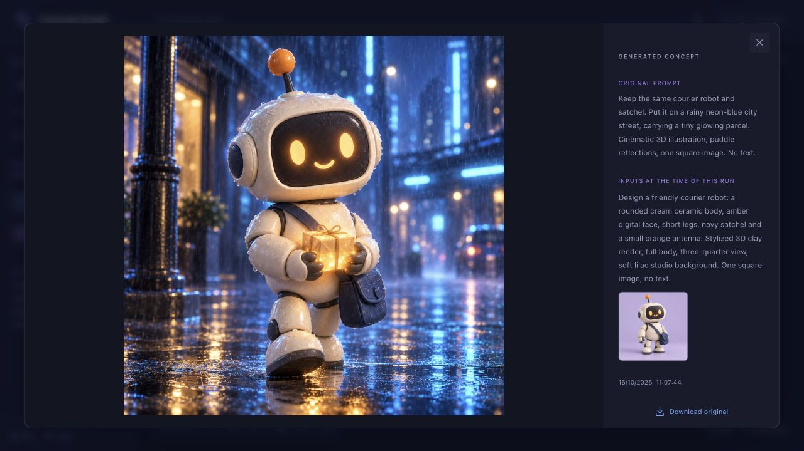

# Concept Graph

[English](README.md) | **Українська**

**Локальне полотно для візуальних ідей та їхнього розвитку.**

Напишіть запит, під'єднайте референси й запустіть генерацію. Зображення з'являться як пов'язані вузли. Створюйте нові гілки від будь-якого результату, порівнюйте різні напрями та зберігайте весь шлях розвитку ідеї.

Під час активних запусків з’являються тимчасові вузли результатів із зацикленими відео без звуку (для текстових описів — мерехтіння), а особистий перемикач **Відео під час генерації** у вікні **Налаштування** або системне зменшення руху замінює відео спокійним мерехтінням.



Concept Graph доступний як попередня версія настільного застосунку з локальним сервером, що використовує Codex CLI; його також можна запустити з вихідного коду в браузері. Це незалежний проєкт, а не продукт OpenAI.

Хмарні вкладки пропонують **Перезавантажити** або **Пізніше**, коли доступна нова версія застосунку. Кнопка генерації показує **Готово до генерації**, коли обраний генератор або типовий генератор нових промптів може скористатися доступним ключем команди; вона й далі відкриває під’єднання Codex і ШІ-агентів. Якщо референси перевищують вхідний ліміт автоматичного зменшення, **Зменшити всі й згенерувати** разом зменшує завеликі референси без масок до типового розміру з діалогу **Змінити розмір…**, а тоді повторює запуск промпта. Зміну розміру можна скасувати; із референсів з масками спочатку потрібно зняти маску.

## Можливості

- На хмарних командних дошках перетворюйте 1–4 під’єднані зображення на окремі вузли **3D-моделі** через fal.ai: Hunyuan 3D ($0.375), TRELLIS 2 ($0.30), Rodin ($0.40) або Tripo H3.1 ($0.30). Обертайте моделі на дошці, відкривайте **Інфо** (генератор, дату, автора, час генерації, вартість, вихідне зображення, розмір файлу, трикутники, текстури), вмикайте **Каркас**, щоб роздивитися сітку, завантажуйте GLB, відкривайте більший переглядач або вибирайте **Зберегти ракурс як зображення**, щоб використати його як референс у промпті. Адміністратори надають доступ до 3D кожній людині окремо в **Доступі команди**, незалежно від Nano Banana / GPT Image. Кожна модель зараховується як одне денне зображення, а її вартість — до бюджету команди; обмеження GLB — 80 МБ. Редактори також можуть додавати GLB, glTF, OBJ, FBX, STL, PLY, 3MF або USDZ через **Додати 3D-модель із файлу**, перетягування на полотно або вставлення: інші формати перетворюються на GLB у браузері, який створює прев’ю, а **Інфо** показує відомості про початковий файл. Вибирайте супровідні файли (як-от .mtl, .bin і текстури) разом із моделлю або запакуйте їх у ZIP. STL/PLY імпортуються без текстур; кольори вершин зберігаються, якщо вони є. Загальний розмір файлів обмежено 300 МБ, включно з розпакованими, а кожного отриманого GLB — 80 МБ. Для додавання файлів не потрібен доступ до генераторів і плата за генерацію не стягується. Додавання моделей із файлів і генерація доступні лише на хмарних дошках. [Налаштування й обмеження](docs/cloud-preview.md#3d-models).

- На хмарних командних дошках обрізайте зображення зі збереженням оригіналу та малюйте маску, щоб перегенерувати вибрану область через GPT Image, Nano Banana або Codex. Відкрийте **Обрізати** або **Маска** в меню зображення чи повноекранному перегляді; глядачі не можуть редагувати.
- На хмарних командних дошках промпт для Nano Banana або GPT Image створює **1, 2, 4, 8 або 16** варіантів за одне натискання **Згенерувати** — або будь-яку кількість до **32**, якщо ввести її в поле поруч. Вони генеруються до чотирьох одночасно й з’являються одним слайд-шоу; коли на одній дошці генерують кілька людей водночас, дошка ставить виклики в чергу (**У черзі**), щоб не взяти більше, ніж може втримати. Кожен варіант зараховується як одне з денних зображень людини (типово 100) і до місячного бюджету команди (типово $100); запуск, що не вміщується в ліміти, відхиляється ще до початку.
- Промпт для Codex — у застосунку й на сайті — має такі самі кнопки варіантів. Окремого налаштування кількості в Codex немає, тому вибране число додається до запиту як суворе правило: рівно стільки зображень, хай яке число названо в тексті промпту. Codex створює їх одне за одним за один запуск, і вони з’являються одним слайд-шоу. Якщо кількість не вибрано, як і раніше вирішує текст промпту. Кожне зображення витрачає ваш власний ліміт ChatGPT.
- Промпти зображень і вузли **Описати зображення** показують під налаштуваннями окрему кнопку для кожної доступної моделі: **Codex**, **Nano Banana**, **GPT Image** (для описів: **Codex**, **Gemini**, **GPT**). Натискайте різні моделі, щоб запустити один промпт паралельно: кожна має власну смугу завантаження, час виконання та кнопку скасування для того, хто її запустив. Модель із вичерпаним лімітом лишається видимою, але неактивною. Коли готові лише API-моделі, **Підключити Codex** є в меню **⋯**; без доступу до API єдина кнопка Codex за потреби відкриває налаштування. Те саме меню показує спільні ліміти та **Попросити доступ…**, щоб адміністратори розглянули запит у **Доступі команди**. Локальний застосунок показує лише Codex. Остання натиснута модель стає типовою для цього промпта в **⌘Enter** / **Ctrl+Enter**, налаштуваннях і MCP `start_run`; нові промпти запам’ятовують останню доступну вам модель.
- Кнопка налаштувань праворуч у рядку варіантів промпта задає **пропорції**, **розмір** (1K, 2K або 4K), **мислення** (Nano Banana) або **якість** (GPT Image) і **прозорий фон** (GPT Image). Те, що генератор не підтримує, показано неактивним із поясненням; для Codex пропорції й фон додаються до промпта як підказка, а розмір Codex обирає сам. Унизу видно оцінку, яку резервують із бюджету команди.
- На хмарних командних дошках у деталях згенерованого зображення видно **референсні зображення**, які отримав запуск, разом із референсами кастомної ноди; клацніть на одне, щоб відкрити його.
- На хмарних командних дошках завеликі для генератора референси автоматично надсилаються зменшеними копіями, а оригінал на дошці лишається без змін. **Змінити розмір…** у меню зображення або повноекранному перегляді зменшує його вручну, а **Повернути початковий розмір** повертає оригінал.
- На хмарних командних дошках **Chat** зберігає повідомлення, сповіщає про непрочитане та дозволяє посилатися на вузли, а **Voice** дає змогу спілкуватися голосом одночасно вісьмом людям. У панелі голосового чату можна запросити тих, хто зараз на дошці (вони побачать картку з кнопкою **Join voice**), або скопіювати посилання-запрошення для будь-кого з доступом до дошки. Учасники з правом перегляду теж можуть долучатися; хмарні MCP-агенти можуть читати й надсилати повідомлення. Голосове з’єднання працює напряму між учасниками, за потреби через Cloudflare TURN, без запису. [Налаштування хмари та приватність](docs/cloud-preview.md#text-and-voice-chat).

- Поєднуйте текстові вузли та зображення, щоб задавати контекст для генерації або редагування.
- Вставляйте текст і зображення безпосередньо на полотно; дублюйте ноди, копіюйте картинки та ID нод для агентів.
- Наведіть курсор на картку зображення й натисніть **Завантажити** в її правому верхньому куті, щоб зберегти зображення в повному розмірі під його назвою.
- Нова секція одразу відкриває поле для назви. Виділіть секцію за назвою (і здалеку теж), щоб перемістити її або змінити розмір за кути за будь-якого масштабу.
- На хмарних командних дошках верхня панель показує значок робота на аватарці кожного, чий ШІ-агент (MCP) зараз працює на дошці, і вашій теж. **Підключити ШІ-агента (MCP)…** показує ваших під’єднаних агентів, коли агент востаннє працював, і дає їх від’єднати.
- Утримуйте Alt (Option на Mac), перетягуючи картку, виділення, групу чи секцію, щоб витягнути копію й залишити оригінал на місці; Escape під час перетягування скасовує копію.
- Перетягніть вихід вузла на порожнє місце, щоб створити нову гілку й одразу написати наступний запит.
- Результати з’являються одразу праворуч від промпту, на рівні його верхнього краю, а зображення одного запуску — в одному стовпці. Якщо це місце зайняте, запуск із полотна стає на найближче вільне місце праворуч від промпту або під ним у межах того, що ви бачите на екрані в момент натискання (ніколи ліворуч чи вище); якщо вільного місця на екрані немає, результат з’явиться на екрані поверх інших карток, і його можна перетягнути. Зображення одного запуску тримаються разом в одному стовпці, доки запуск не згорнеться в картку слайд-шоу. Запуски, які стартує агент, стають під попередні результати промпту.
- Панель генерацій угорі полотна згортається в компактний підсумок, а завершені результати зникають самі невдовзі після того, як ви їх побачили. Ваші помилки лишаються, доки ви їх не закриєте, а **Історія** зберігає всі запуски.
- Створюйте окремі дошки, згортайте групи, вирівнюйте гілки та масштабуйте полотно за вибраними вузлами.
- Зображення одного запуску автоматично об’єднуються в групу в міру появи, а коли запуск завершується, група згортається в картку слайд-шоу. Якщо згрупувати зображення, які всі походять з одного промпту, теж вийде згорнуте слайд-шоу. У згорнутому вигляді група стає карткою слайд-шоу, лінії з’єднань проходять під нею, а в контекстному меню є **Bring to front** і **Send to back**: гортайте зображення по одному й тягніть з’єднання від картки, щоб використати показане як референс. У розгорнутому вигляді кожне зображення можна під’єднати окремо. Будь-яку групу із зображеннями можна перемкнути між слайд-шоу та звичайною групою в її контекстному меню.
- Згортайте окремі текстові ноди та зображення в компактні квадратики.
- Описуйте зображення текстом: під’єднайте зображення до ноди Describe image (або виберіть Describe image на зображенні), і Codex напише детальний опис у новий текстовий промпт, який можна редагувати, генерувати з нього або використовувати як контекст. Необов’язковий фокус, наприклад «лише освітлення», спрямовує опис. На сайті опис робить оновлений хелпер або, для тих, кому це дозволено, ключ Gemini чи OpenAI сайту: натисніть кнопку **Gemini** або **GPT** цієї ноди.
- Переглядайте початкові запити та вхідні зображення попередніх генерацій; завантажуйте оригінали результатів.
- Відкривайте діагностику запуску в **History**, щоб переглянути доступні повідомлення агента, налаштування моделі, події та помилки.
- Запускайте генерацію зображень без сторонніх skills, плагінів і налаштованих MCP-серверів Codex, не змінюючи глобальних налаштувань.
- Експортуйте дошку разом із зображеннями в один файл `.conceptgraph` та імпортуйте його як нову дошку.
- Зберігайте кастомні текстові ноди з інструкціями й референсами та перемикайте тип наявних промптів.
- Над кожним розгорнутим зображенням видно назву, яку можна змінити. Використовуйте саме цю назву в запитах, наприклад «візьми хмари зі Storm 3, а ракурс із Canyon». Кожен генератор отримує підключені зображення з їхніми назвами на дошці. У запиті на підключене зображення можна послатися й через ID ноди (**Копіювати ID ноди** у контекстному меню) або назву файлу, яку видно в повноекранному перегляді й під час завантаження; кожен генератор отримує для кожного зображення всі три варіанти.
- Виділіть промпт, і на зв’язку кожного під’єднаного зображення з’явиться номер: **1, 2, 3…** у порядку, в якому ви їх під’єднували. Номер тримається на видимій частині зв’язку, навіть коли саме зображення за межами екрана. Посилайтеся на зображення за цими номерами, наприклад «зроби другу картинку як першу»; кожен генератор отримує ті самі номери (#1, #2…). Назва в лапках, як і раніше, означає зображення саме з такою назвою. На хмарних командних дошках ці номери видно й на референсах запуску в деталях зображення.
- Підключайте локального агента з підтримкою MCP, щоб переглядати й змінювати дошки, аналізувати зображення та запускати генерацію.
- На хмарних дошках дія **Копіювати посилання на ноду** в контекстному меню ноди дає посилання, яке відкриває дошку одразу на цій ноді для людей із доступом до неї.
- Робіть нотатки довкола ідей, як у FigJam: малюйте пером, додавайте стікери, штампи й секції, ставте прямокутники, еліпси, ромби й трикутники з текстом усередині (R, O) і з’єднуйте елементи стрілками (L), які лишаються прикріпленими, коли елементи рухаються.
- Видаляйте непотрібні дошки; для підтвердження треба ввести назву дошки. Полотно закінчується трохи за межами вмісту дошки, тож на ньому неможливо загубитися.
- Перемикайте мову інтерфейсу між англійською та українською. Доки ви її не виберете, вона відповідає мові браузера.
- За замовчуванням тема відповідає системній; виберіть **Light**, **Dark** або **System** у **Settings** («Налаштування»). Дошки автоматично зберігаються на вашому комп’ютері.

Новачкові спершу показують на **+ Текстовий промпт**, щоб написати й запустити перший промпт; підказка про власні вузли чекає до його першого зображення. Кругла кнопка **?** відкриває меню з пунктами **Getting started** («Початок роботи», лише для редакторів, із прогресом незавершених кроків), **Keyboard shortcuts** («Клавіатурні скорочення») та **What's new** («Що нового»). Натисніть **?** поза текстовим полем, щоб відкрити скорочення. Скорочення працюють за будь-якої розкладки клавіатури, зокрема української. Групуйте виділене через ⌘G (Ctrl+G), а розгруповуйте через ⌘⇧G (Ctrl+Shift+G). Змінюйте, вимикайте або скидайте власні скорочення в **Settings** («Налаштування») → **Keyboard shortcuts** («Клавіатурні скорочення»); вони особисті й зберігаються на цьому пристрої. Крапка позначає новинки, які ще не переглядали в цьому браузері; відкриття **What's new** прибирає її. Довідка відкривається за запитом; автоматичної екскурсії інтерфейсом немає.

Шукайте **CUSTOM NODES** («Власні ноди») у вкладці **Create** («Створення»): натисніть **+ New custom node** або виберіть звичайний промпт і скористайтеся **Save as custom node** на його рухомій панелі чи в контекстному меню. На командних дошках **Copy from another board…** копіює вибрані власні ноди на поточну дошку; кожну копію можна редагувати незалежно. Дії з дошкою, зокрема **Version history** («Історія версій») на командних дошках, доступні в меню назви дошки.


### Відео (хмарні дошки)

Одна нода **Відео** перемикається між MiniMax H3 (типово), Gemini Omni Flash 1.2, Kling 4.0 та Seedance 2.5 через ключ fal.ai сайту. Знайдіть модель у бічній панелі або виберіть **Створити відео** в меню зображення. Під’єднані зображення зберігають номери й призначені ролі початкового / кінцевого / проміжного кадру або референсу. Несумісні поєднання блокують генерацію; після зміни моделі налаштування зберігаються, а картка показує застосовані обмеження та приблизну вартість. Alt-перетягування дублює ноду разом із входами для порівняння моделей.

Типові оцінки для класу 720p: MiniMax $0.06/с ($0.08/с у режимі референсів), Omni $0.0819/с, Kling $0.157/с та Seedance $0.473/с; ціни приблизні, плата за референси й токени може відрізнятися. Потрібен окремий персональний доступ **Відео** в розділі **Доступ команди**; кожна генерація враховується як одне денне зображення, а її оцінена вартість — у спільному бюджеті команди. MP4-результати (до 128 МБ) мають програвач, завантаження, повноекранний режим та відомості про генерацію; при віддаленні картки показують прев’ю (початкове зображення, а для відео без нього — перший кадр, який один раз малює браузер редактора й зберігає на дошці). Картки на екрані грають без звуку по колу, якщо не вимкнути **Автоматично грати відео на картках** у **Налаштуваннях** (без збереженого вибору діє системне зменшення руху). Кнопки 1× / 2× / 3× на картці пришвидшують відтворення для всіх на дошці; «Завантажити MP4» і «Відкрити» дають оригінальну швидкість. Формат типово **Авто**: він береться з входів (генерація лише з тексту — 16:9; Omni вибирає 16:9 або 9:16). Експорт та історія версій зберігають відеофайли (формат архіву 11). Під’єднайте згенероване відео або перетягніть, вставте чи виберіть власний MP4 у вікні «Зображення-референс» (максимум 128 МіБ). Для завантажених відео зберігаються визначені браузером тривалість і розміри та прев’ю, якщо його вдалося створити. Відеовходи типово мають роль відеореференсу; Seedance також пропонує редагування (автоматичні тривалість і формат) та продовження (автоматичний формат). Зображення та відео мають спільну нумерацію #1/#2; несумісні ролі, кількість, тривалість або відомі розміри й частота кадрів блокують генерацію. Seedance вимагає 24–60 кадрів/с; якщо частота невідома, її перевіряє fal. Аудіореференси, інші додаткові параметри моделей і паралельна генерація недоступні.

Ліміти відеореференсів: MiniMax — 2–15 с кожне та 15 с разом (12 файлів-референсів); Omni — до 3 відео, до 15 с кожне; Kling — до 5, по 3–30 с, разом до 30 с; Seedance — до 10, по 1,8–30,2 с, разом до 30,2 с. Із відеовходами оцінка Kling становить $0.094/с для 720p або $0.141/с для 1080p за суму вхідних і вихідних секунд (щонайменше подвійну тривалість результату); Seedance множить тариф на 0,6 і враховує вхід та вихід. MiniMax оцінює додаткові токени референсів за опублікованою таблицею для 24 кадрів/с після спільного включеного ліміту 4096 токенів ($0.02 за 1000 додаткових токенів); частота кадрів і формат можуть змінити суму. Omni додає $1.50 за мільйон вхідних токенів; тут прийнято 1024 токени на секунду відео, оскільки fal не публікує перерахунку. Це оцінки для бюджету, а не точні рахунки провайдера. MCP під’єднує наявні відеоноди через `add_video_node.videoInputs` або `connect_nodes`; завантаження MP4 наразі доступне в інтерфейсі дошки.

## Попередня настільна версія

Настільна версія містить Node.js і шукає встановлений Codex CLI. Якщо його немає, застосунок запропонує завантажити окрему перевірену копію; дошки залишаться доступними й у разі відмови. Увійдіть у власний обліковий запис ChatGPT, коли застосунок запропонує це зробити. Версію для macOS на Apple Silicon перевірено локально; публічну збірку для Apple Silicon підписано Developer ID і нотаризовано Apple. Версія для Windows x64 потребує WebView2 Runtime; її кроскомпільовано, але ще не перевірено на Windows. Збірки Windows — непідписані портативні ZIP-архіви, тому операційна система може показати попередження про безпеку. Попередні версії не оновлюються автоматично. Докладніше — в [інструкції зі збирання та налаштування](docs/desktop-preview.md).

У настільній версії відкрийте меню статусу **Codex** у верхній панелі й виберіть **Connect an AI agent (MCP)…** («Підключити ШІ-агента (MCP)…»), щоб скопіювати інструкцію для локального агента Codex або Claude Code. Concept Graph має залишатися відкритим. Підключений агент може читати й змінювати дошки та зображення й запускати генерацію; див. [посібник з MCP](docs/mcp.md).

## Вимоги для запуску з коду

- **Node.js 22 або новіший** і npm.
- **Codex CLI з вбудованою генерацією зображень**, з авторизацією через ваш власний обліковий запис ChatGPT.
- Браузер. Запуск із коду перевірено локально на macOS; автоматичні перевірки CI також працюють на Linux. Роботу безпосередньо у Windows не перевірено; для Unix-середовища можна використати WSL2.

Застосунок навмисно не приймає авторизацію через API-ключ для генерації. Він використовує можливості та ліміти вашого облікового запису Codex; підписка не гарантує доступу до всіх функцій або необмеженої кількості генерацій. Перед запуском застосунок перевіряє підтримку генерації зображень. Перевірену версію CLI та поради щодо усунення несправностей наведено в [посібнику з налаштування англійською](docs/setup.md#codex-compatibility).

## Швидкий запуск із вихідного коду

Установіть [Node.js](https://nodejs.org/en/download), потім установіть Codex і увійдіть у свій обліковий запис:

```sh
npm install -g @openai/codex@0.163.0
codex login
```

Виберіть **Sign in with ChatGPT**, а потім виконайте:

```sh
git clone https://github.com/knifest-studio/concept-graph.git
cd concept-graph
npm ci
npm run build
npm start
```

Відкрийте **http://127.0.0.1:4317**. Залишайте термінал відкритим; для зупинки натисніть **Ctrl+C**.

Бажаєте ZIP? Завантажте `concept-graph-v0.1.1.zip` зі сторінки [релізів](https://github.com/knifest-studio/concept-graph/releases), розпакуйте його, виконайте `npm ci --omit=dev`, потім `npm start`. ZIP-архіви релізів містять готовий інтерфейс; автоматичні архіви GitHub **Source code** потребують збирання. Node.js і Codex встановлюються окремо.

Повні інструкції зі встановлення, оновлення, резервного копіювання та усунення несправностей містяться в **[посібнику з налаштування](docs/setup.md)**. Керування та формат файлів дошок описані в **[посібнику користувача](docs/user-guide.md)**. Ці два докладні посібники наразі доступні англійською.

## Перша гілка

1. Додайте **Text prompt**, опишіть потрібне зображення й натисніть кнопку відтворення.
2. Перетягніть вихідну точку отриманого зображення на порожнє місце. З'явиться пов'язаний текстовий вузол із готовим до введення курсором.
3. Опишіть зміни й запустіть генерацію. Початкове та нове зображення залишаться на дошці.

Надсилаються лише вузли, безпосередньо під'єднані до запиту; те, з чого було створено під'єднане зображення, повторно не надсилається. Непов'язані ідеї не надсилаються. Кожна генерація зберігає початковий запит і вхідні дані, тому подальше редагування не переписує історію.

## Реальний приклад: один персонаж, два напрями

На знімку вище — справжня дошка з трьома зображеннями, створеними через Concept Graph: початковий робот-кур'єр, варіант у місті під дощем і варіант із доставкою в лісі. Обидві гілки використовують початкове зображення як під'єднаний референс.

Файл [прикладу дошки](examples/courier-robot.conceptgraph) включено до репозиторію та ZIP-архівів релізів починаючи з **v0.1.1**: `examples/courier-robot.conceptgraph`. Натисніть **Import** і виберіть цей файл, щоб переглянути запити, зв'язки та завершену історію генерацій. Імпорт додає окрему дошку й нічого не генерує автоматично. Також доступні [окреме завантаження](https://github.com/knifest-studio/concept-graph/releases/download/v0.1.0/courier-robot.conceptgraph) та [точні тексти запитів](examples/courier-robot.md).

Відкрийте результат, щоб переглянути початковий запит і зображення, які фактично використовувалися під час цієї генерації:



## Дані та приватність

Лише на хмарному сайті аналітика використання та записи сеансів увімкнені за замовчуванням для покращення інтерфейсу. Ми збираємо дані пристрою, розміру вікна й навігації, натискання кнопок і клавіатурні скорочення, зміни теми, використання довідки та дії з власними нодами (без їхнього вмісту), ID дощок і сторінок, типи вузлів, результати й тривалість генерацій, помилки (їхній тип, файл, рядок і стовпець у власному коді застосунку, де вони сталися, і чи це відомий шум браузера або розширення), які сповіщення було показано (за фіксованою назвою, ніколи не за їхнім текстом), результати голосових дзвінків (з’єдналося, не вдалося чи минув час очікування, тип мережевого шляху — напряму, через роутер чи через relay-сервер, — чи було запропоновано relay, кількість аудіопакетів і загальна гучність в обидва боки, чи йшло відтворення, фіксовані коди помилок і заблокований браузером звук; ніколи не IP-адреси чи сам звук), версію збірки застосунку та активність у сеансі. Записи показують лише розташування інтерфейсу та взаємодію з ним: вміст дощок, промпти, зображення, назви дощок і сторінок, імена людей, чат і всі введені значення приховані. Усі поля вводу замасковані; зображення, відео та canvas замінені порожніми блоками того самого розміру. Маскований текст зберігає довжину, щоб розташування елементів залишалося зрозумілим. Із підписів контролів і відомих повідомлень про помилки вилучаються користувацькі значення; деталі невідомих помилок, зокрема стек викликів, приховані. Сервер прив’язує email облікового запису до сеансу, щоб адміністратори бачили, кому з колег складно користуватися інтерфейсом; у самому записі інтерфейсу email прихований. Дані зберігаються у власному сховищі Cloudflare D1/R2 сайту та доступні лише адміністраторам сайту. Події взаємодії та метадані сеансів зберігаються 180 днів, записи — 30 днів; їх видаляє щоденне очищення. Сторонні сервіси аналітики цих даних не отримують. У **Settings** вимкніть **Share usage data and session recordings to improve Concept Graph** («Ділитися даними використання та записами сеансів для покращення Concept Graph»), щоб зупинити збір і надсилання в цьому браузері; це не видаляє вже надіслані дані. Локальний настільний застосунок цієї аналітики не збирає. Дивіться сторінку `/privacy` хмарного сайту. Сторінка аналітики також показує адміністраторам сайту, скільки генерацій на командних ключах зробила кожна людина і скільки з них запустив її ШІ-агент (MCP); ці дані беруться з обліку для спільних лімітів, тому не залежать від налаштування в браузері. **Адмін-панель** (меню облікового запису, лише для власника сайту) показує всіх, хто входив: у кого сайт відкритий у видимій вкладці просто зараз і на якій дошці, коли кожна людина була востаннє, її власні дошки й дошки, куди її запросили, генерації на командних ключах сьогодні й цього місяця, витрати цього місяця, коли востаннє працював її ШІ-агент, перший і останній вхід. Хто онлайн, сервер тримає лише в пам’яті; час останнього відвідування зберігається разом з email. Це теж не залежить від налаштування в браузері.

Сервер слухає `127.0.0.1`. Під час запуску з коду дошки зберігаються в `data/workspace.json`, а зображення — у `data/assets/`. Настільна версія за замовчуванням використовує `~/Library/Application Support/Concept Graph` на macOS або `%LOCALAPPDATA%\Concept Graph\data` на Windows. Щоб змінити папку, виберіть **Concept Graph → Storage Location…** на macOS або **Storage → Change Storage Folder…** на Windows. Робіть резервну копію **всього каталогу даних** або експортуйте окрему дошку. Експорт містить запити, оригінали зображень, історичні вхідні дані, а також інструкції та референси кастомних нод: перевірте вміст перед поширенням.

Діагностика запусків зберігається локально та включається до експорту дошки. Повідомлення агента й помилки можуть містити чутливу інформацію; перевіряйте експорт перед поширенням.

Коли ви запускаєте запит, під'єднані тексти й зображення надсилаються до OpenAI. Авторизацією окремо керує Codex; застосунок не включає й не поширює облікові дані. Модель довіри локального застосунку описана в [примітках із безпеки](SECURITY.md). Не відкривайте доступ до цього сервера як до публічного або спільного сервісу.

## Розробка

```sh
npm ci
npm test
npm run build
npm start
```

Тести використовують детермінований підставний процес Codex і не звертаються до OpenAI. Для експериментів задайте окремий каталог через `CONCEPT_GRAPH_DATA`. Застосунок побудовано на React і React Flow, невеликому HTTP-сервері Node.js та JSON-RPC-з'єднанні з `codex app-server`.

Інструкції з розробки й випуску релізів містяться в [CONTRIBUTING.md](CONTRIBUTING.md), а перелік змін — у [CHANGELOG.md](CHANGELOG.md).

## Поточні обмеження

Одна активна генерація на всі дошки; до 10 референсних зображень на запит, включно з референсами кастомних нод; до 30 МБ на зображення, а файл понад 30 МБ або 16 384 px завантажується зменшеною копією. На сайті під’єднуйте локальний хелпер у Chrome: Safari та вбудовані браузери, як-от у Telegram, не дають https-сторінці зв’язатися з хелпером на `127.0.0.1`, і під’єднання завершується помилкою «Load failed». Групи мають один рівень вкладеності. Історія скасування дій очищується після перемикання дошки або перезавантаження сторінки. Під час запуску з коду використовуйте одну вкладку браузера на дошку. Під час генерації показується кількість секунд від початку, оскільки Codex не надає достовірного відсотка готовності чи прогнозу часу завершення. Автоматичні назви описують запитаний результат і можуть бути неточними. Нові зображення отримують унікальні назви в межах усіх сторінок дошки. Для завантажень використовується назва файлу без розширення, для вставлених зображень із загальними назвами та результатів без підпису від моделі — наступна вільна назва `Image N`, а для збільшених зображень — назва оригіналу з доданим `upscaled`. Натисніть назву, щоб змінити її. Копії зберігають свої назви. Старі зображення без збереженої назви показують назву файлу без розширення або `Image` й отримують збережену унікальну назву під час підключення до запиту. Експорт із кастомними нодами використовує формат дошки версії 2, дошки з підписами або старими налаштуваннями підписів — версії 3, а дошки з фігурами чи стрілками — версії 7, з обрізанням або масками — версії 8, а з 3D-моделями — версії 9. Старі версії застосунку не можуть імпортувати новіші формати.

Інтеграція з Codex app-server експериментальна й може потребувати змін після оновлення Codex. Приклад дошки створено від початку до кінця за допомогою публічного CLI **0.163.0** з авторизацією через ChatGPT. CI перевіряє застосунок із підставним процесом; доступ до облікового запису та справжня генерація перевіряються окремо вручну.

## Ліцензія

[MIT](LICENSE). Сторонні залежності зберігають власні ліцензії; див. [THIRD_PARTY_NOTICES.md](THIRD_PARTY_NOTICES.md).
