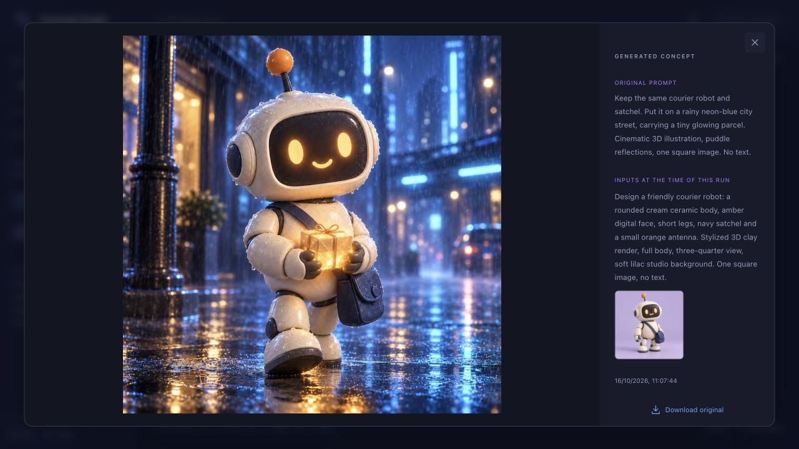

# Concept Graph

[English](README.md) | **Українська**

**Локальне полотно для візуальних ідей та їхнього розвитку.**

Напишіть запит, під'єднайте референси й запустіть генерацію. Зображення з'являться як пов'язані вузли. Створюйте нові гілки від будь-якого результату, порівнюйте різні напрями та зберігайте весь шлях розвитку ідеї.


Concept Graph працює у браузері через локальний сервер Node.js і Codex CLI, у якому ви увійшли у свій обліковий запис. Це незалежний проєкт, а не продукт OpenAI.

## Можливості

- Поєднуйте текстові вузли та зображення, щоб задавати контекст для генерації або редагування.
- Вставляйте текст і зображення безпосередньо на полотно; дублюйте, копіюйте та вставляйте вибрані вузли.
- Перетягніть вихід вузла на порожнє місце, щоб створити нову гілку й одразу написати наступний запит.
- Створюйте окремі дошки, згортайте групи, вирівнюйте гілки та масштабуйте полотно за вибраними вузлами.
- Переглядайте початкові запити та вхідні зображення попередніх генерацій; завантажуйте оригінали результатів.
- Експортуйте дошку разом із зображеннями в один файл `.conceptgraph` та імпортуйте його як нову дошку.
- Перемикайте світлу й темну теми. Дошки автоматично зберігаються на вашому комп'ютері.

## Вимоги

- **Node.js 22 або новіший** і npm.
- **Codex CLI з вбудованою генерацією зображень**, з авторизацією через ваш власний обліковий запис ChatGPT.
- Браузер. Застосунок перевірено локально на macOS; автоматичні перевірки CI також запускаються на Linux. Роботу безпосередньо у Windows наразі не перевірено; для Unix-середовища використовуйте WSL2.

Застосунок навмисно не приймає авторизацію через API-ключ для генерації. Він використовує можливості та ліміти вашого облікового запису Codex; підписка не гарантує доступу до всіх функцій або необмеженої кількості генерацій. Перед запуском застосунок перевіряє підтримку генерації зображень. Перевірену версію CLI та поради щодо усунення несправностей наведено в [посібнику з налаштування англійською](docs/setup.md#codex-compatibility).

## Швидкий запуск із вихідного коду

Установіть [Node.js](https://nodejs.org/en/download), потім установіть Codex і увійдіть у свій обліковий запис:

```sh
npm install -g @openai/codex@0.163.0
codex login
```

Виберіть **Sign in with ChatGPT**, а потім виконайте:

```sh
git clone https://github.com/knifest-studio/concept-graph.git
cd concept-graph
npm ci
npm run build
npm start
```

Відкрийте **http://127.0.0.1:4317**. Залишайте термінал відкритим; для зупинки натисніть **Ctrl+C**.

Бажаєте ZIP? Завантажте `concept-graph-v0.1.1.zip` зі сторінки [релізів](https://github.com/knifest-studio/concept-graph/releases), розпакуйте його, виконайте `npm ci --omit=dev`, потім `npm start`. ZIP-архіви релізів містять готовий інтерфейс; автоматичні архіви GitHub **Source code** потребують збирання. Node.js і Codex встановлюються окремо.

Повні інструкції зі встановлення, оновлення, резервного копіювання та усунення несправностей містяться в **[посібнику з налаштування](docs/setup.md)**. Керування та формат файлів дошок описані в **[посібнику користувача](docs/user-guide.md)**. Ці два докладні посібники наразі доступні англійською.

## Перша гілка

1. Додайте **Text prompt**, опишіть потрібне зображення й натисніть кнопку відтворення.
2. Перетягніть вихідну точку отриманого зображення на порожнє місце. З'явиться пов'язаний текстовий вузол із готовим до введення курсором.
3. Опишіть зміни й запустіть генерацію. Початкове та нове зображення залишаться на дошці.

У контекст потрапляють лише попередні вузли, пов'язані з поточним запитом. Непов'язані ідеї не надсилаються. Кожна генерація зберігає початковий запит і вхідні дані, тому подальше редагування не переписує історію.

## Реальний приклад: один персонаж, два напрями

На знімку вище — справжня дошка з трьома зображеннями, створеними через Concept Graph: початковий робот-кур'єр, варіант у місті під дощем і варіант із доставкою в лісі. Обидві гілки використовують початкове зображення як під'єднаний референс.

Файл [прикладу дошки](examples/courier-robot.conceptgraph) включено до репозиторію та ZIP-архівів релізів починаючи з **v0.1.1**: `examples/courier-robot.conceptgraph`. Натисніть **Import** і виберіть цей файл, щоб переглянути запити, зв'язки та завершену історію генерацій. Імпорт додає окрему дошку й нічого не генерує автоматично. Також доступні [окреме завантаження](https://github.com/knifest-studio/concept-graph/releases/download/v0.1.0/courier-robot.conceptgraph) та [точні тексти запитів](examples/courier-robot.md).

Відкрийте результат, щоб переглянути початковий запит і зображення, які фактично використовувалися під час цієї генерації:



## Дані та приватність

Сервер слухає `127.0.0.1`. Дошки зберігаються в `data/workspace.json`, а зображення — у `data/assets/`. Робіть резервну копію **всього каталогу data** або експортуйте окрему дошку для обміну. Експорт містить тексти запитів, оригінали зображень та історичні вхідні дані: перевірте його вміст перед поширенням.

Коли ви запускаєте запит, під'єднані тексти й зображення надсилаються до OpenAI. Авторизацією окремо керує Codex; застосунок не включає й не поширює облікові дані. Модель довіри локального застосунку описана в [примітках із безпеки](SECURITY.md). Не відкривайте доступ до цього сервера як до публічного або спільного сервісу.

## Розробка

```sh
npm ci
npm test
npm run build
npm start
```

Тести використовують детермінований підставний процес Codex і не звертаються до OpenAI. Для експериментів задайте окремий каталог через `CONCEPT_GRAPH_DATA`. Застосунок побудовано на React і React Flow, невеликому HTTP-сервері Node.js та JSON-RPC-з'єднанні з `codex app-server`.

Інструкції з розробки й випуску релізів містяться в [CONTRIBUTING.md](CONTRIBUTING.md), а перелік змін — у [CHANGELOG.md](CHANGELOG.md).

## Поточні обмеження

Одна активна генерація на всі дошки; до 10 під'єднаних вхідних зображень на запит; до 30 МБ на зображення. Групи мають один рівень вкладеності. Історія скасування дій очищується після перемикання дошки або перезавантаження сторінки. Використовуйте одну вкладку браузера на дошку. Під час генерації показується кількість секунд від початку, оскільки Codex не надає достовірного відсотка готовності чи прогнозу часу завершення.

Інтеграція з Codex app-server експериментальна й може потребувати змін після оновлення Codex. Приклад дошки створено від початку до кінця за допомогою публічного CLI **0.163.0** з авторизацією через ChatGPT. CI перевіряє застосунок із підставним процесом; доступ до облікового запису та справжня генерація перевіряються окремо вручну.

## Ліцензія

[MIT](LICENSE). Сторонні залежності зберігають власні ліцензії; див. [THIRD_PARTY_NOTICES.md](THIRD_PARTY_NOTICES.md).
